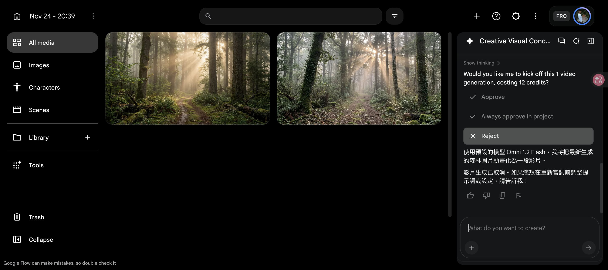
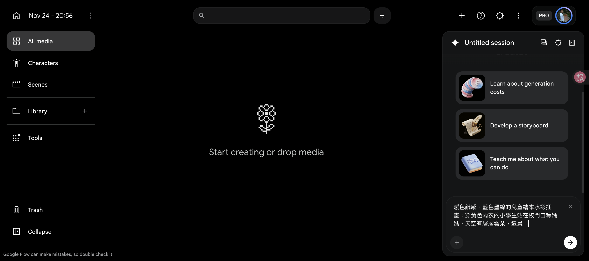
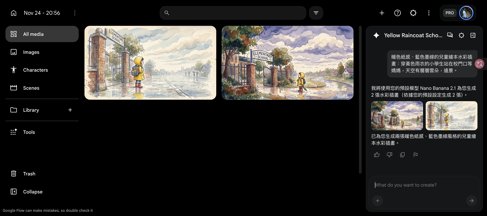
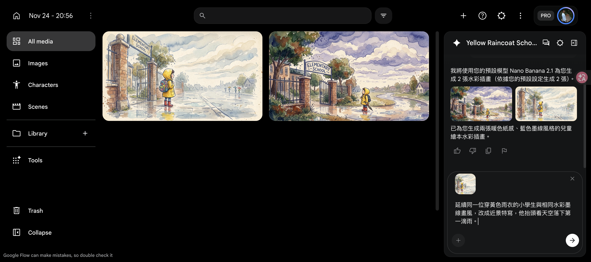
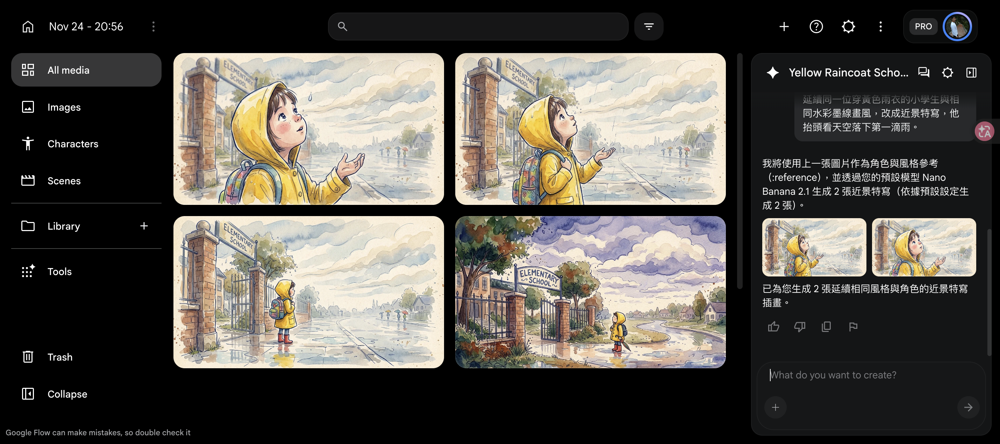
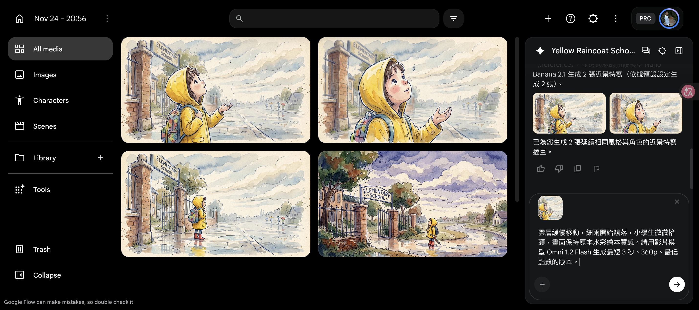
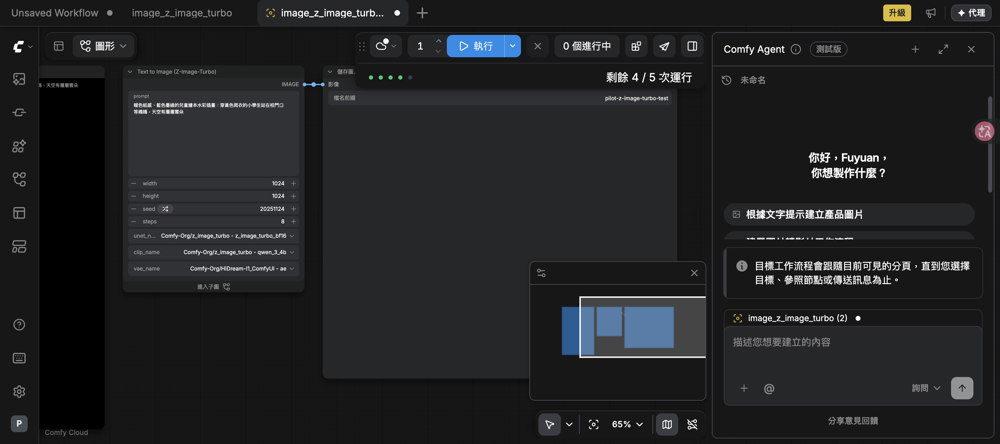
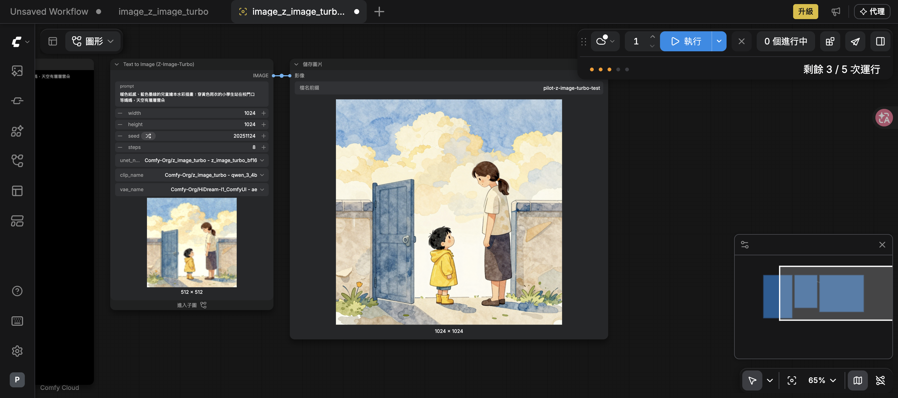
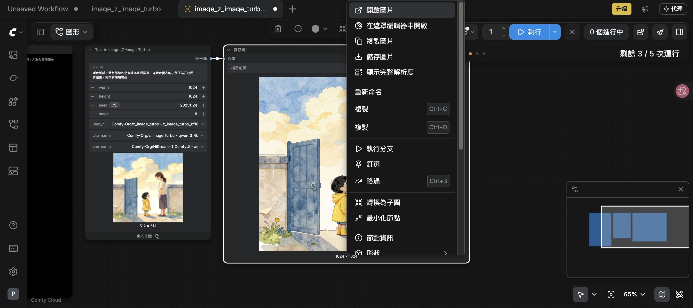

# 用 Google Flow 與 Comfy Cloud 做一頁繪本：學生按圖索驥版

查核日期：2026-11-24
實測環境：macOS + Brave，無獨立顯卡；兩個工具都在瀏覽器裡跑。
適用對象：會開瀏覽器、會存檔，但沒學過專業繪圖軟體與 AI 流程的同學。

## 開始前：每個人都要有自己的帳號

兩位工具都採「一人一帳號、一人一份額度」。不要跟同學借帳號，也不要把自己的額度分給別人。

| 工具 | 網址 | 註冊方式 | 額度怎麼算 |
| --- | --- | --- | --- |
| Google Flow | `https://flow.google.com/` | 用**自己的** Google 帳號登入即開通 | 圖片生成 0 點（頁面顯示「Generating will use 0 credits」，查核日 2026-11-24）。影片另計點數 |
| Comfy Cloud | `https://cloud.comfy.org/` | 用**自己的** Google 帳號免費註冊 | 每人各自 5 次免費運行（本次實測帳號顯示「剩餘 4 / 5 次運行」） |

重點：**5 次是「每個人」的 5 次，不是全班共用 5 次。** 班上 30 人就有 30 份獨立的 5 次，互不影響。反過來說，你自己只有 5 次，所以每次按「執行」前要先想清楚。

教室電腦不需要獨立顯卡，也不需要安裝任何軟體。只要瀏覽器能開這兩個網站就行。

---

# 第一章｜Google Flow：用繁體中文就能下指令

## 1-1 開一個新專案

1. 開啟 `https://flow.google.com/`。
2. 用學校或個人的 Google 帳號登入。
3. 按左上角「新增」，建立一個新專案。
4. 把專案改名成「你的名字 + 繪本名稱」，方便之後交作業。



驗收點：畫面左側看得到 `All media`、`Images`、`Characters`、`Scenes`、`Library`、`Tools`；上方是你自己的專案名稱。

## 1-2 上傳自己的手繪草圖

1. 把草圖畫在紙上，拍照或掃描。
2. 存成 JPG 或 PNG，檔名用英文，例如 `raincoat-sketch.png`。
3. 回到 Flow 專案，按輸入框左邊的「**＋**」。
4. 在選單中選「**上傳媒體**」。
5. 在跳出的視窗中選你自己的草圖檔案。
6. 確認草圖縮圖出現在輸入框左下角。

驗收點：輸入框左邊出現一張縮圖。沒有縮圖，就是沒上傳成功，重做第 3 到第 5 步。

> 本次自動化實測紀錄：機器人無法在不開啟系統檔案視窗的前提下把草圖送進 Flow。拖曳到頁面與直接尋找檔案欄位各試 1 次都失敗（Flow 的檔案欄位要按下「上傳媒體」才會產生）。
> **真人在電腦教室直接按「＋」→「上傳媒體」→ 選自己的草圖檔即可，這條路徑不需要任何技巧。**
> 因此下面 1-3 的截圖是「純文字提示詞」的設定畫面，不是草圖上傳後的畫面。

## 1-3 用繁體中文寫風格指令

在輸入框打中文就好，不必翻成英文。把「保留什麼」與「變成什麼」分開寫。

範例（本次實測用過、可運作的寫法）：

```
請保留這張手繪草圖的構圖與角色位置，畫成暖色紙感、藍色墨線的兒童繪本水彩插畫：
穿黃色雨衣的小學生站在校門口等媽媽，天空有層層雲朵。
```

沒有上傳草圖時，把第一句刪掉：

```
暖色紙感、藍色墨線的兒童繪本水彩插畫：穿黃色雨衣的小學生站在校門口等媽媽，天空有層層雲朵，遠景。
```



驗收點：送出前，輸入框裡看得到完整中文句子，而且句子裡有「主體（誰）＋動作（在做什麼）＋畫風（長什麼樣）＋場景」四件事。

按右下角「**送出**」（箭頭圖示）開始生成。

## 1-4 看結果，並且記下等了多久

1. 送出後看畫面中央。生成中會出現「取消」。
2. 等圖片出現，不要重新整理頁面。
3. 一次會出 2 張，挑 1 張當主角。



驗收點：畫布上出現 2 張同主題的圖；右側對話區出現「已為您生成兩張……」的回覆。

實測數字（2026-11-24）：

| 項目 | 數值 |
| --- | --- |
| 模型 | Nano Banana 2.1（預設） |
| 每次產出 | 2 張 |
| 扣點 | 0 點（頁面顯示「Generating will use 0 credits」） |
| 等待時間 | 送出後 159 秒仍在生成，4 分鐘內完成 2 張（精確完成秒數未記錄） |

教學重點：這不是「按了就秒出」。一堂課要留 2 到 4 分鐘的等待，等待時可以先寫下一格的文字。

## 1-5 鎖定同一個角色，生成下一格

1. 在畫布上點選你要延續的那張圖。
2. 按輸入框左邊的「**＋**」。
3. 在「Recent」清單中找到剛生成的圖，按「**Add to prompt**」。
4. 確認縮圖出現在輸入框左下角（這就是「參考圖」）。
5. 在輸入框用繁體中文寫下一格，並且明確寫「延續」：

```
延續同一位穿黃色雨衣的小學生與相同水彩墨線畫風，改成近景特寫，他抬頭看天空落下第一滴雨。
```



驗收點：輸入框左下角有 1 張參考縮圖，輸入框裡有中文句子，句子裡出現「延續」與「相同畫風」。

6. 按「送出」，等結果。



驗收點：新圖的角色仍是黃色雨衣、同一個水彩墨線畫風；只換了景別（遠景 → 近景）與動作（站著 → 抬頭）。

實測數字：模型回覆「我將使用上一張圖片作為角色與風格參考（:reference）」，一次出 2 張，扣 0 點。

判讀方式：把 1-4 與 1-5 的圖並排。若角色臉型、雨衣顏色、線條粗細都對得上，就代表「參考圖」有效。對不上，就是提示詞沒有寫「延續」與「相同畫風」，回去補。

## 1-6 轉成 3 秒動態繪本

最低成本的設定是「3 秒 / 360p / 3 點」（成本表來源：Flow 專案內「Learn about generation costs」，查核日 2026-11-24）。

1. 點左側「**Scenes**」。
2. 按輸入框「＋」，把剛生成的繪本圖加入。
3. 用繁體中文寫動態指令：

```
雲層緩慢移動，細雨開始飄落，小學生微微抬頭，畫面保持原本水彩繪本質感。
```

4. 確認模型是影片模型（Omni 1.2 Flash），時長選 3 秒、解析度選 360p。
5. 按「執行」，記下開始時間與扣點。



**本次實測結果：卡在模型選單，未產出影片。**

- 點開模型選單後，只列出 `Nano Banana Pro`、`Nano Banana 2 Lite`、`Nano Banana 2.1` 三個**影像**模型。
- 選單裡沒有 Omni 1.2 Flash 或 Veo 系列，因此無法選 3 秒 360p。
- 依任務規範最多試 2 次，第 2 次仍只看到影像模型，於是如實跳過，未扣任何點數。
- `07-flow-frames-result.png` 因此不存在，本文件不引用它。

給你的做法：如果你的帳號模型選單裡有 Omni 1.2 Flash，就照上面第 4、5 步做，並在紀錄表寫下實際扣點。如果沒有，就跳過這一步，改用「連續兩張靜態圖 + 口白」交件，不要為此加購點數。

---

# 第二章｜Comfy Cloud：點開老師的連結，只改 2 格

## 2-1 註冊自己的帳號

1. 開啟 `https://cloud.comfy.org/`。
2. 用**自己的** Google 帳號註冊並登入。
3. 登入後確認右上角出現自己的名字。

驗收點：畫面右上角顯示你自己的帳號名稱，不是同學的名字。

## 2-2 開啟老師分享的工作流

1. 開啟老師給的連結：`https://cloud.comfy.org/?share=2999a427439a`。
2. 在跳出的視窗按「**開啟工作流程**」。
3. 系統會在你的工作區建立一份**新副本**，不會改到老師的原始檔。
4. 看畫面右上方，記下「剩餘 X / 5 次運行」。


驗收點：畫布上出現 `Text to Image (Z-Image-Turbo)` 與 `儲存圖片` 兩個節點；分頁名稱變成 `image_z_image_turbo (2)`；右上角顯示剩餘次數。

實測數字：開啟後顯示「剩餘 4 / 5 次運行」。

## 2-3 只改這 2 格

模板已經把模型、步數、尺寸都鎖好了。你只需要動兩個地方。

**第 1 格：prompt（提示詞）**

1. 點 `Text to Image (Z-Image-Turbo)` 節點裡的 prompt 文字框。
2. 全選舊文字，換成你自己的中文句子。
3. 按一下畫布空白處，讓文字框失焦（重要，沒失焦不會寫進節點）。

範例（本次實測用過、可運作）：

```
暖色紙感、藍色墨線的兒童繪本水彩插畫：穿黃色雨衣的小學生站在校門口等媽媽，天空有層層雲朵
```

**第 2 格：seed（種子）**

1. 找到 `seed` 欄位。
2. 換成一個固定數字，例如 `20251124`。
3. 按一下畫布空白處。



驗收點：prompt 節點裡是中文；`seed` 顯示你填的數字；`width`、`height` 仍是 1024；`steps` 仍是 8。**這三個數字不要動**，動了就不是同一組對照。

為什麼要固定 seed：seed 相同、提示詞相同，出來的圖才會一樣。你要比較「換一句話差在哪」，就得把 seed 鎖住，一次只改一個變數。

## 2-4 按執行，並且計時

1. 看畫面右上角記下剩餘次數（例如 4 / 5）。
2. 按下「**執行**」。
3. 看節點上的進度圈，不要重複按。
4. 圖片出現在 `儲存圖片` 節點後，看剩餘次數變成多少。



驗收點：`儲存圖片` 節點出現 1024 × 1024 的圖；右上角剩餘次數少 1。

實測數字（2026-11-24）：

| 項目 | 數值 |
| --- | --- |
| 模型 | Z-Image-Turbo（文字編碼器 `qwen_3_4b`） |
| 設定 | 1024 × 1024、steps 8、seed 20251124 |
| 等待時間 | 63 秒內完成（送出後第一次查看時已完成） |
| 剩餘次數 | 4 / 5 → 3 / 5，消耗 1 次 |

## 2-5 中文到底行不行：實測結論

**行。** 本次直接輸入繁體中文，模型畫出「穿黃色雨衣的小孩、暖色紙感、水彩墨線、層層雲朵」的圖，主體與畫風都對上。

原因線索：這個工作流的文字編碼器是 `Comfy-Org/z_image_turbo - qwen_3_4b`，Qwen 系列本來就擅長中文（此為推論，不是頁面明示）。

建議寫法：中文一句到底就好，不要中英混雜。真的要更穩，可以用「中文 + 英文關鍵詞」對照：

```
暖色紙感、藍色墨線的兒童繪本水彩插畫，穿黃色雨衣的小學生站在校門口等媽媽 / children's picture book watercolor, warm paper texture, blue ink line
```

## 2-6 存圖與分享

1. 在 `儲存圖片` 節點上按**右鍵**。
2. 選「**顯示完整解析度**」先看清細節。
3. 再按右鍵，選「**儲存圖片**」把圖存到自己的資料夾。
4. 需要給老師看流程時，按右上角「分享」，先儲存工作流再建立連結。



驗收點：你的資料夾裡有一張 1024 × 1024 的 PNG，檔名開頭是 `pilot-z-image-turbo-test`。

分享連結只讓別人「看得到、用得到」這個工作流。別人按執行時，扣的是**他自己**的額度，不是你的。

---

# 第三章｜堅持純手繪的同學，三種借力接法

你不必讓 AI 畫你的圖。你可以只借它一件事，然後把主權拿回來。

**接法 1：線稿試色打光**
先用 Flow 生成 3 到 5 張不同配色與光線的版本（0 點，不心痛）。手繪時只抄色票與光影位置，線條與構圖自己畫。
紀錄要寫：借了哪個色、哪個光源方向；沒借它的線條與構圖。

**接法 2：透視參考**
請 Flow 生成同一個場景的俯視與平視版本，用來確認消失點與前中後景關係。角色與物件自己畫。
紀錄要寫：借了哪條消失點、哪個景深層次。

**接法 3：手繪完稿進 Flow 變動態繪本**
手繪首張與尾張，掃描上傳，用 Flow 做 3 秒動態（最低 3 點）。AI 補錯的幀，自己修掉或直接刪掉。
紀錄要寫：哪幾幀是 AI 補的、你修了什麼。

三種接法的共同規則：**每次借力都要留一行紀錄——借了什麼、沒借什麼、為什麼。** 這一航紀錄就是你的作業分數來源之一。

---

# 第四章｜交作業前必留的紀錄

交件時附上這張表，缺一項就退回。

| 要留的東西 | 具體內容 | 為什麼要留 |
| --- | --- | --- |
| 版本 | 每次生成的日期、模型名稱、提示詞全文 | 證明這張圖是你做的，不是撿來的 |
| 設定 | seed、尺寸、steps（Comfy Cloud）；時長、解析度（Flow 影片） | 讓別人能重跑出同一張圖 |
| 額度 | 用了幾次、剩幾次（Comfy Cloud）；扣了幾點（Flow 影片） | 證明你沒有超用，也讓下一屆知道成本 |
| 條款 | 工具名稱、方案（免費 / 付費）、查核日期 | 免費方案的商用範圍會變，要留當時的證據 |
| 來源 | 參考圖網址、素材授權、是否含他人作品 | 避免侵權，也保護你自己 |

最後檢查三件事：

1. 每一張圖都能說出「哪一句提示詞、哪一個 seed」。
2. 免費方案產出的圖，不要直接寫「可商用」。先回頭看當時的方案條款，並記下查核日期。
3. 不要把同學的照片、私人資料或未授權的他人畫作貼進工具。

---

## 附錄：本次實測數據總表

| 項目 | 結果 | 證據 |
| --- | --- | --- |
| Flow 繁體中文生圖 | 成功，一次 2 張，0 點 | `03-flow-zh-sketch-result.png` |
| Flow 等待時間 | 159 秒仍在生成，4 分鐘內完成 | 本次計時紀錄 |
| Flow 草圖上傳（自動化） | 失敗 2 次，改走純文字提示詞 | 本文件 1-2 節說明 |
| Flow 一致風格延伸 | 成功，角色與畫風延續 | `05-flow-consistent-result.png` |
| Flow 3 秒動態 | 未執行：模型選單無影片模型 | `06-flow-frames-setup.png` |
| Comfy Cloud 開分享連結 | 成功，建立新副本，剩餘 4 / 5 | `01-comfycloud-open-share.png` |
| Comfy Cloud 中文提示詞 | 支援，主體與畫風正確 | `03-comfycloud-generated-result.png` |
| Comfy Cloud 執行 1 次 | 63 秒內完成，剩餘 4 / 5 → 3 / 5 | `03-comfycloud-generated-result.png` |
| Comfy Cloud 存圖路徑 | 右鍵 → 顯示完整解析度 / 儲存圖片 | `04-comfycloud-download-and-share.png` |

## 來源與查核日期

- Google Flow：`https://flow.google.com/`，模型與扣點顯示、成本表，查核日 2026-11-24。
- Comfy Cloud：`https://cloud.comfy.org/`，工作流 `image_z_image_turbo`，分享連結 `https://cloud.comfy.org/?share=2999a427439a`，查核日 2026-11-24。
- 免費工具與權利邊界：本 repo `AGENTS.md`。
